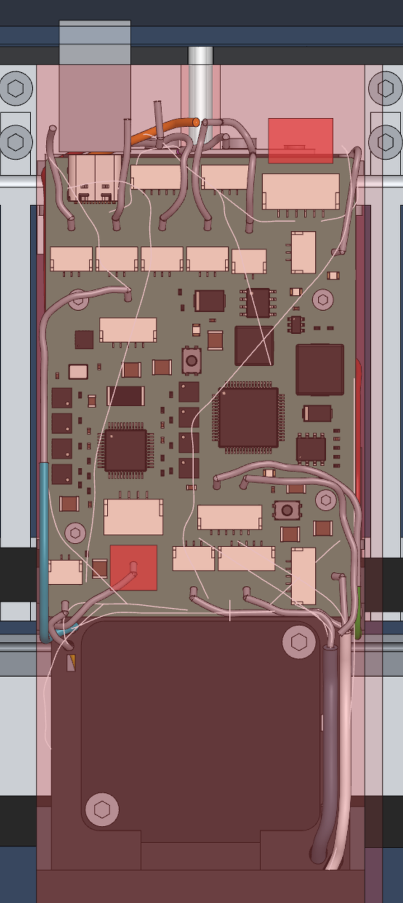
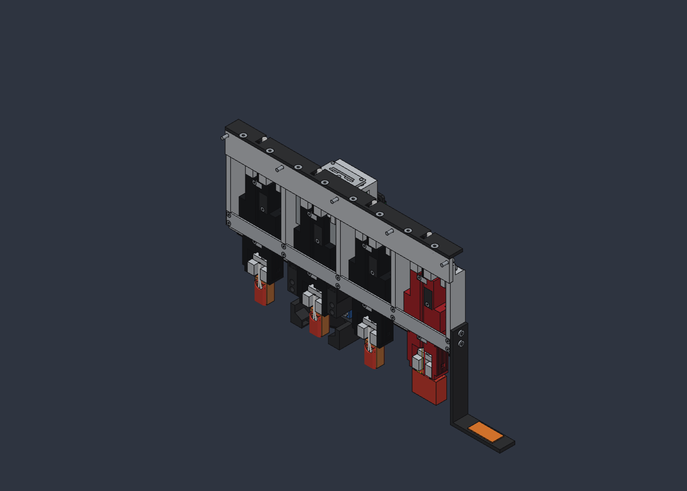
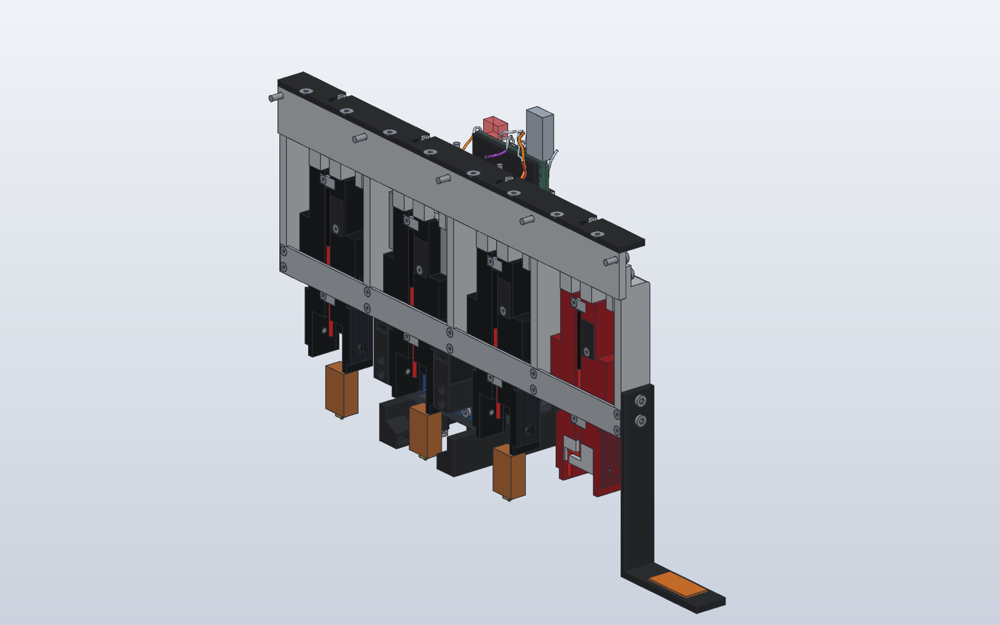
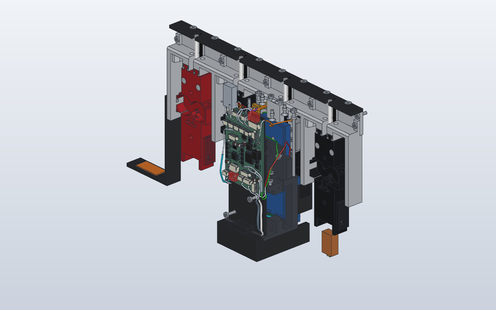
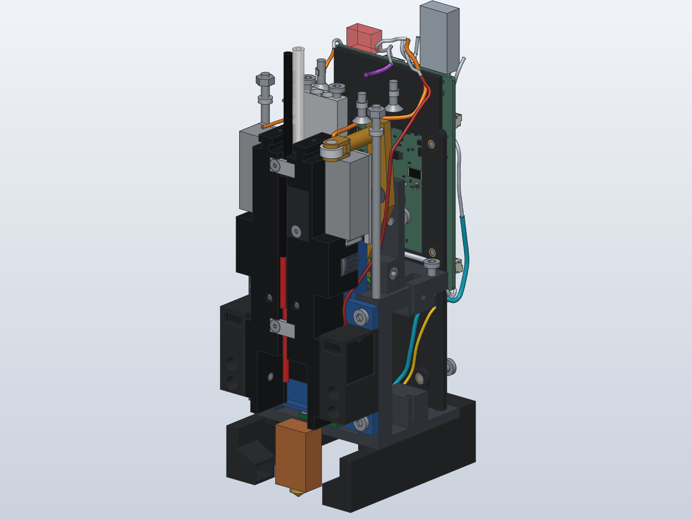
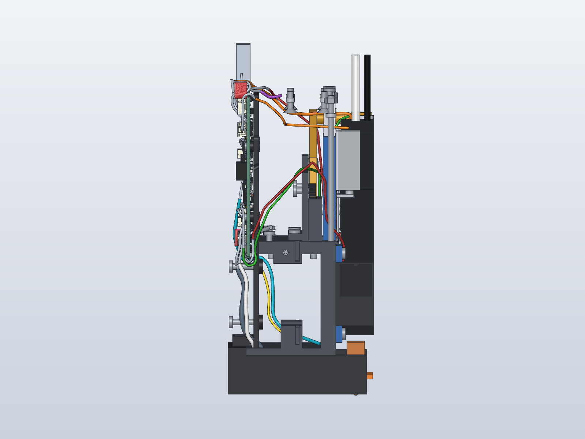
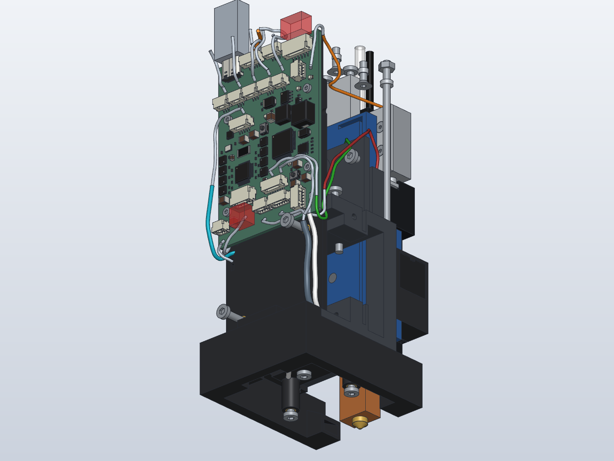
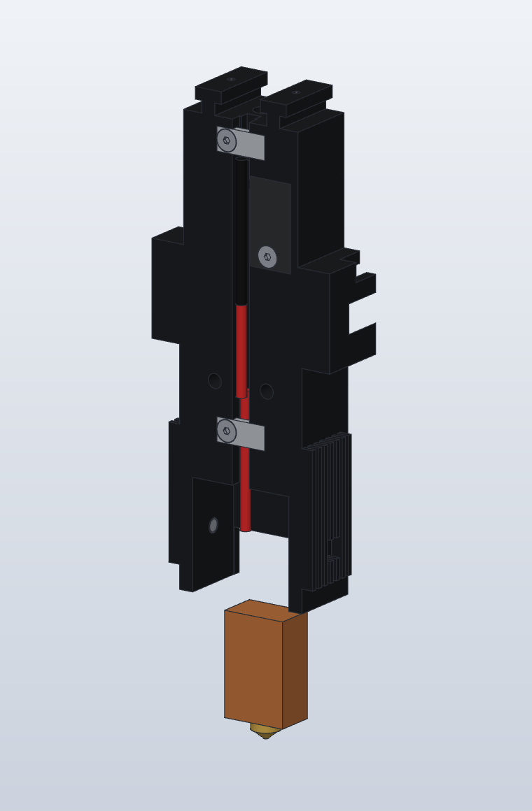
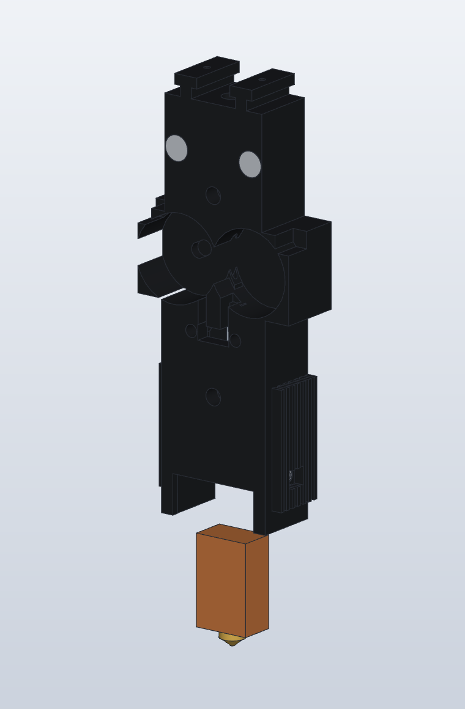

# Prototyp 19 v2 – Mechanik des Düsenwechslers

**English summary:** Prototype 19 v2 is the current mechanical design of the tool changer for the Creality K2 Plus. A fixed print
head carries the filament drive, a spring-loaded latch opened by two small solenoids, the sensors and the new toolhead board; each
colour sits in its own aluminium cartridge with a complete hotend. Up to four cartridges park in a passive dock above the front
door (no power, no sensors in the dock); a change only needs forward/backward moves of the head. The design was checked in CAD
and by calculation (collisions, assembly, FEM, heat, tolerances, change time); it has not been built or tested yet.
CAD files are in `cad/` (reference models of third-party parts removed).

Stand: noch nicht gebaut und nicht erprobt. Alle Zahlen unten stammen aus dem CAD-Modell und aus Rechnungen und Simulationen
mit teils angenommenen Kaufteildaten; an echten Teilen ist davon noch nichts bestätigt.

*Kopf von hinten (CAD, 22.11.2026): Kopfplatine P19 Fassung 10 mit den verlegten Geräteleitungen, darunter der Bauteillüfter.*

*Ablage mit vier Plätzen und Bürstenstation rechts, schräg von vorn (CAD, Stand 11.11.2026 – Einzelheiten der Patronen haben
sich seitdem geändert).*

## Ansichten

Alle Bilder in diesem Abschnitt stammen aus dem CAD-Modell in `cad/` (Stand 22.11.2026). Begrenzungskörper des Druckers
(Tür, Glas, Bett, Bauraumgrenzen) sind ausgeblendet.

### Gesamtansicht

*Von vorn (Türseite), schräg von oben: Ablage an der Wandschiene mit drei geparkten Patronen und der Bürstenstation rechts,
dahinter der Kopf mit der vierten Patrone. Der rote Teil am rechten Platz ist der Adapter für das Original-Hotend des K2 Plus.*

*Von hinten, schräg von oben: Kopf mit Kopfplatine vor der Ablage; darüber die Strangführung für die Filamentschläuche.*

### Kopf

Für die Kopfansichten sind Ablage und Strangführung ausgeblendet; am Kopf sitzt eine Patrone.

*Kopf mit verriegelter Patrone, schräg von vorn: Patrone mit Hotend unten, seitlich die beiden Hubmagnete des Riegels,
oben der Filamenteinlauf, hinten die Kopfplatine.*

*Seitenansicht: links (hinten) die Kopfplatine mit den Leitungen, in der Mitte Kopfrahmen und Koppelplatte, rechts (vorn)
die Patrone mit dem Heizblock unten.*

*Schräg von hinten unten: Kopfplatine mit Steckern und verlegten Leitungen, darunter Düsenkanal und Bauteillüfter; ganz
unten die Düse der Patrone.*

### Patrone

 

*Einzelne Patrone (Aluminium 7075) mit Hotend, links schräg von vorn, rechts schräg von hinten. Vorn liegen in der Kabelnut
die Adern des Patronenkabels (schwarz) und die daran verlöteten Hotend-Leitungen (rot), seitlich die Kühlrippen. Auf der
Rückseite, die am Kopf anliegt, sitzen die beiden Druckscheiben für die Kugeln der 3-2-1-Kupplung.*

## Begriffe

| Begriff | Bedeutung |
|---|---|
| **Kopf** | der Druckkopf auf dem X-Wagen des K2 Plus (Linearführung MGN12C); bleibt immer am Drucker |
| **Patrone** | wechselbare Einheit: gefrästes Aluminiumteil mit Kühlrippen, darin ein komplettes Hotend und der Filamentweg einer Farbe |
| **Hotend** | heißer Teil: Düse, Heizblock mit Heizung und Temperaturfühler, Heatbreak (Übergang heiß/kalt) |
| **Ablage** | Parkplätze für die gerade nicht benutzten Patronen, vorne an der Wand über der Tür |
| **Koppelplatte (KP)** | Platte am Kopf, an der die Patrone sitzt; über ein Festkörpergelenk minimal beweglich, damit ein Wirbelstromsensor die Förderkraft messen kann |
| **Andocken** | der Kopf fährt nach vorn in einen Ablageplatz, bis Patrone, Kopf und Ablage aneinander anliegen |
| **CFS** | die Filamentzufuhr des K2 Plus (Creality Filament System) |

## Grundsätze der Konstruktion

- **Keine Druckfläche verlieren.** Die Düse liegt genau dort, wo die Original-Düse liegt; der Kopf reicht nach hinten nicht
  weiter als der Original-Kopf, ist nicht breiter (55 mm), und die Ablage passt in den 29,6 mm breiten Raum zwischen Düse und Tür.
  Am CAD gerechnet sind alle vier Richtungen eingehalten, teils ohne Reserve.
- **Wechsel nur durch Vor- und Zurückfahren** (Y-Richtung), kein seitliches Einfädeln; Aufbau möglichst symmetrisch.
- **Patrone immer mechanisch gehalten:** entweder am Kopf verriegelt oder in der Ablage eingerastet, beim Übergeben kurz beides.
  Magnete sind nie der einzige Halt.
- **Ablage passiv:** kein Strom, kein Sensor, kein Kabel in der Ablage. Welche Patrone wo liegt, merkt sich die Steuerung aus dem
  Ablauf.
- **Universelle Patrone:** Jede Patrone passt auf jeden Platz und nimmt jedes vorgesehene Hotend auf; Unterschiede stecken nur in
  einem Adaptersatz. Die Düsenspitze liegt bei allen Hotend-Typen am selben Punkt.
- Am Slicer muss nichts geändert werden; alle Anpassungen gehören in die Druckerkonfiguration.

## Aufbau

### Kopf

- **Kopfrahmen** (Aluminium 6082, gefräst) auf dem Wagen der X-Achse, mit den Riemenklemmen des Druckers.
- **Koppelplatte** (Aluminium 7075) mit Festkörpergelenk. Die Patrone wird über eine **3-2-1-Kupplung** ausgerichtet: zwei Kugeln
  Ø 6 mm auf Druckscheiben, ein Rundstift und ein Rautenstift Ø 4 mm. Gerechnete Wiederholgenauigkeit der Düsenlage in Z: etwa
  ±0,02 mm (Vorgabe ±0,1 mm). Den verbleibenden Versatz jeder Patrone misst der Cartographer-Sensor einmal ein.
- **Riegelmodul:** zwei Hubmagnete ITS-LS 1110b (24 V) öffnen einen federbelasteten Rollenriegel. Ohne Strom ist der Riegel zu.
  Die nötige Vorspannung (etwa 40 N) entsteht beim Andocken: Der Kopf drückt die Patrone gegen einen festen Anschlag der Ablage
  und spannt dabei ein steifes Federelement im Riegelmodul; dann rastet der Riegel formschlüssig dahinter. Ein Hall-Sensor (G1)
  meldet „Riegel zu/offen“. Weil der Riegel unbelastet öffnet, haben die Magnete laut Rechnung etwa fünffache Kraftreserve.
- **Fördertechnik:** Extrudermotor (vorgesehen LDO-36STH20, Untersetzung 6/48), Förderräder in der Bauform HGX 36Z, schwenkbarer
  Andruckarm. Der Arm öffnet sich beim Andocken an einem Nocken der Ablage. Ein analoger Hall-Sensor am Arm (G2) erkennt
  „Filament da / leer / Arm offen“.
- **Förderkraftmessung:** Eine Wirbelstromspule (LDC1612, Bauform der Bambu-Lab-Spule) unter der Koppelplatte misst deren
  Auslenkung und damit die Förderkraft (Verstopfung, Schlupf). Das System soll auch ohne diese Spule laufen.
- **PRTouch:** Die Original-Messplatte des K2 Plus (Dehnungsmessstreifen) bleibt im Kraftweg der Düse; ausgewertet wird sie auf der
  neuen Kopfplatine.
- **Kühlung:** Bauteillüfter 4010 mit eigenem Düsenkanal (Druckteil), zwei Radiallüfter 1510, die die Kühlrippen der angedockten
  Patrone anblasen.
- **Sensoren unten:** Cartographer (Bettvermessung, Z-Antasten, Düsenversatz je Patrone), Linienlaser und Bettkamera wie beim
  Original.
- **Kopfplatine P19** hinten in der Platinenebene, starr am Kopfrahmen (wegen des Beschleunigungssensors). Beschreibung:
  [`../toolhead-pcb/README.md`](../toolhead-pcb/README.md).

### Patrone

- Gefrästes Teil aus Aluminium 7075, eloxiert, mit Kühlrippen, einer Kammer für den Riegel, einer geraden Kabelnut und zwei
  T-Leisten auf der Oberseite, an denen die Patrone in der Ablage hängt.
- Vorgesehene Hotend-Typen (je mit eigenem Adapter):
  - Bambu-Lab-Bauform (z. B. TZ2.0 / TZ-E3 2.0 und kompatible), Keramikheizer, bis 300 °C;
  - Micro Swiss FlowTech für den K2 Plus als Hochtemperatur-Variante bis 350 °C;
  - das Original-Keramik-Hotend des K2 Plus (Adaptersatz mit wärmedämmenden Hülsen).
- Jede Patrone hat ein **eigenes 7-adriges Kabel** nach oben (Heizung 2 Adern, Temperaturfühler 3 Adern für NTC oder PT1000,
  Backup-Filamentschalter 2 Adern) und einen **eigenen PTFE-Schlauch** (PC4) zum CFS. Die Leitungen des Hotends werden in der
  Kabelnut mit den Adern des Patronenkabels verlötet (Schrumpfschlauch); an der Patrone sitzt keine Platine.
- Nachrüstbarer **Backup-Filamentschalter** (Omron D2F-01FL) je Patrone; ohne Schalter verschließt ein Blinddeckel den Schacht.
- Heizung und Temperaturfühler jeder Patrone hängen an einer eigenen **Heizplatine** (nicht an der Kopfplatine). Diese ist noch
  ein Konzept und nicht Teil dieses Repositorys.

### Ablage

- Vier Plätze im Abstand von 62 mm plus eine **Bürstenstation** (Silikonbürste zum Abwischen der Düse) rechts daneben.
- Getragen wird von oben: Eine **Wandschiene** (Aluminium 6082) an der Blechwand über der Tür trägt fünf Wangen (Aluminium 6082,
  gefräst), in denen die Schienen für die T-Leisten der Patronen liegen.
- **Rastung** je Platz mit zwei Kugeldruckstücken (GN 615, M3). Gerechnet: Einrasten etwa 8 N, Herausziehen etwa 9 N.
- Durchgehende **Anschlagleiste** aus Federstahl (1.4310, 1,5 mm) im Spalt vor der Tür; an ihr wird beim Andocken die Vorspannung
  des Riegels aufgebaut.
- Eine **Strangführung** oben (unter der Glasauflage des Deckels) hält Kabel und Filamentschläuche der Patronen.
- Die Wangen waren zuerst als Druckteile geplant; die Festigkeitsrechnung zeigte, dass Kunststoff dort zu weich ist.

## Ablauf eines Wechsels

**Ablegen** (Patrone vom Kopf in einen freien Platz):

1. Kopf auf eine sichere Y-Lage, dann in X vor den Platz.
2. Langsam nach vorn einfahren: Der Andruckarm öffnet am Nocken, die T-Leisten gleiten in die Schienen.
3. In der Endlage rasten die Kugeldruckstücke ein, die Patrone liegt am Anschlag.
4. Hubmagnete an – der Riegel öffnet (unbelastet).
5. Kopf fährt zurück, Hubmagnete aus.

**Aufnehmen** (Patrone aus der Ablage):

1. Vor dem Platz Hubmagnete an (Riegel offen).
2. Einfahren: Stifte der Koppelplatte gehen in die Bohrungen der Patrone, der Arm öffnet.
3. In der Endlage Hubmagnete aus – die Feder schließt den Riegel, Sensor G1 meldet „zu“, Sensor G2 meldet Arm/Filament.
4. Zurückfahren: Die Patrone wird aus der Rastung gezogen.

Gerechnete Wechselzeit (Ablegen + Aufnehmen, Annahmen: Beschleunigung 20 000 mm/s², langsames Andocken auf den letzten 4 mm,
Hubmagnet 40 ms, Sensorabfragen): **1,38 s** zum Nachbarplatz, **1,63 s** zum entferntesten Platz – ohne Vorheizen und ohne die
Fahrt vom Druckteil zur Ablage. Ziel waren 2 s, höchstens 3 s.

Die nächste Patrone soll schon in der Ablage vorgeheizt werden; die Rechnung empfiehlt etwa 60 s Vollheizen vor dem Aufnehmen und
sonst eine Bereitschaftstemperatur je Filament.

## Was gerechnet bzw. im CAD geprüft wurde

| Prüfung | Ergebnis (gerechnet, nicht gemessen) |
|---|---|
| Platzbedarf (Druckfläche) | hinten, vorn, Breite und Höhe innerhalb der Grenzen des Original-Kopfs; teils ohne Reserve |
| Wechselablauf im CAD (alle Ablege- und Aufnahmefälle, Querfahrten) | keine ungewollte Berührung; nur der gewollte Wischkontakt in der Bürste |
| Montage | jede Schraube mit freier Werkzeugachse erreichbar (123 von 123); zwei Halterschrauben des K2-Original-Hotends nur schräg mit Kugelkopf-Innensechskant |
| Lastfälle (Eigengewicht, 20 000 mm/s², 40 N Förderkraft) | Sicherheit der vorgespannten Kupplung gegen Aufkippen ≥ 1,69 (Vorgabe 1,5) |
| Festigkeit/Steifigkeit (FEM) | Koppelplatte, Riegel, Anschlagleiste und Ablagewangen in Ordnung (Wangen nach Werkstoffwechsel auf Aluminium) |
| Eigenfrequenzen | Kopfrahmen mit Kopf und Patrone erste Eigenfrequenz etwa 195 Hz, deutlich über dem Bereich, in dem der Drucker schwingt |
| Wärme | Kühlkörper der Patrone etwa 83 °C im ungünstigsten Fall (Düse 370 °C, Bauraum 60 °C); mit Original-Hotend bei 350 °C etwa 78 °C |
| Kühlluft | Bauteillüfter-Düsen etwa 10 m/s (Lüfterkennlinie angenommen) |

Die meisten dieser Rechnungen stammen vom 08. bis 14.11.2026. Die danach eingebaute Kopfplatine (Fassung 10) samt Kabeln wurde
im CAD auf Kollisionen und Steckbarkeit geprüft (bis auf kleine Restüberschneidungen mit vereinfachten Stellvertreterkörpern
ohne Befund); Wärme-, Festigkeits- und Ablaufrechnungen wurden dafür nicht wiederholt.

Daraus folgende Vorgaben an Kaufteile: Heatbreak mit hohem Wärmewiderstand (Bimetall oder Titan), Lüfter für 85 °C Umgebung,
Magnete für erhöhte Temperatur.

## Verwendete Kaufteile (Auswahl)

| Gruppe | Teile |
|---|---|
| Antrieb | Extrudermotor LDO-36STH20-1004AHIG (vorgesehen), Förderräder HGX 36Z, Zahnrad 48 Zähne Modul 0,5 mit Ritzel 6 Zähne, Kugellager MR85ZZ, MR63ZZ, MR84ZZ |
| Riegel und Sensoren | 2 × Hubmagnet ITS-LS 1110b (24 V), Hall-Sensoren DRV5032 (digital) und DRV5055 (analog), Wirbelstromspule mit LDC1612, Cartographer V4, Backup-Schalter Omron D2F-01FL |
| Hotends | Bambu-Lab-Bauform (z. B. TZ2.0), Micro Swiss FlowTech für K2 Plus, Original-Hotend des K2 Plus |
| Lüfter | Bauteillüfter 4010, 2 × Radiallüfter 1510 (24 V) |
| Ablage | 8 × Kugeldruckstück GN 615 M3, Silikonbürste |
| Normteile | Linsenkopfschrauben ISO 7380 (bevorzugt), Senkschrauben ISO 10642 wo bündig nötig, Gewindestifte ISO 4026, Einschmelzmuttern und Gewindeeinsätze M2/M3 |
| Sonstiges | PC4-/PTFE-Schläuche, Federn (Druck-, Zug-, Tellerfedern), Stahlkugeln Ø 6 mm, Passstifte |

Gefräste Teile: Patronen, Koppelplatte, Schwenkarm, Rollengabel, Adapter (7075); Kopfrahmen, Messplattenträger, Ablagewangen,
Wandschiene (6082). Blechteile aus Federstahl 1.4310 (Riegelteile, Anschlagleiste). Druckteile aus PA-CF (Halter, Düsenkanal,
Lüfterhalter, Bürstenhalter, Strangführung).

Grobe Kostenschätzung (Stand 11.11.2026, Einzelstück, ohne Versand und Zoll, keine Angebote): etwa 1 400 bis 2 600 € für Kopf,
vier Patronen, Ablage und beide Platinen; der größte Posten sind die Frästeile.

## Offene Punkte

- **Nicht gebaut, nicht erprobt.** Alle Ergebnisse sind Rechnungen am CAD-Modell.
- **Andockkraft:** etwa 50–64 N kurzzeitig. Ob der Y-Antrieb des K2 Plus das sicher aufbringt, ist nur aus einem angenommenen
  Motormoment abgeschätzt; am Drucker mit langsamer Andockfahrt zu bestätigen (sonst weichere Federn).
- **Fahrbereich:** Angedockt steht der Kopf 18,5 mm weiter vorn als am vorderen Druckanschlag. Ob die Y-Grenze der
  Klipper-Konfiguration dafür reicht, ist offen.
- **Kabel- und Schlauchführung** der Patronen vom Kopf bzw. von der Strangführung zum CFS (Schleppschlaufe über das ganze Bett) ist
  nicht ausgelegt.
- **Maße von Kaufteilen:** FlowTech-Hotend ohne verlässliche Maße; Maße am echten K2-Original-Hotend nachprüfen; Lüfterkennlinien,
  Federkräfte der Kugeldruckstücke und Schaltabstände der Hall-Sensoren am Muster bestimmen.
- **Heizplatine** für Heizungen, Fühler und Backup-Schalter der Patronen: nur Konzept.
- **Klipper:** Makros für Ablegen/Aufnehmen, Belegungstabelle und Sensorabfragen liegen nur als Entwurf vor und sind nicht
  veröffentlicht.
- Noch nicht festgelegt: Zielgewicht (bewegte Masse laut Bilanz vom 08.11.2026 etwa 570 g für Kopf und Patrone, seitdem nicht neu
  bilanziert), Messfrequenzen der beiden LDC1612, endgültiger Extrudermotor.

## CAD-Daten

Im Ordner [`cad/`](cad/): das SolidCraft-Modell mit Entstehungsgeschichte, dieselbe Baugruppe als STEP und die acht Druckteile
als STL. Bezugsmodelle von Druckerteilen und Kaufteilen, die nicht aus diesem Projekt stammen, sind daraus entfernt – was
fehlt und warum, steht in [`cad/LIESMICH.md`](cad/LIESMICH.md).
