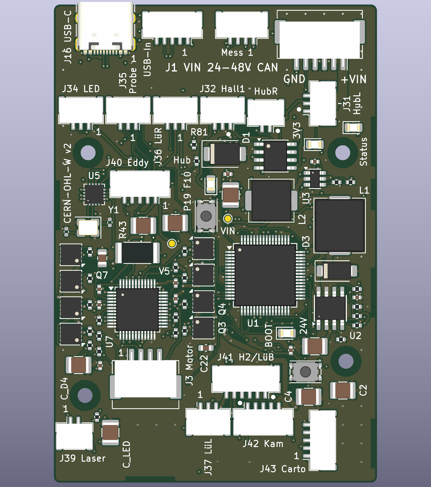

# Kopfplatine P19, Fassung 10 – Toolhead-Platine für den K2-Düsenwechsler

**English summary:** This is the toolhead board for the K2 Plus nozzle changer (prototype 19 v2). It replaces the original
toolhead board, runs from 24–48 V, talks to the Klipper host via CAN bus and additionally provides USB through an on-board
4-port hub (bed camera, Cartographer probe, MCU). It carries an STM32G0B1 MCU, a TMC5160 stepper driver with external MOSFETs,
a 24-bit load-cell ADC, an accelerometer, five low-side outputs and all sensor inputs on 14 locking JST GH connectors.
The KiCad files are produced by a Python generator (`bauen.sh`); Gerber, BOM and CPL files for JLCPCB are included.
Status: not yet manufactured or tested.

Stand: Schaltplan und Layout sind vollständig und bestehen die automatischen Prüfungen; gefertigt oder in Betrieb genommen
wurde die Platine noch nicht. Lizenz und Haftung: [`../LIZENZ-UND-HAFTUNG.md`](../LIZENZ-UND-HAFTUNG.md).



## Aufgabe

Die Platine sitzt hinten am Druckkopf des Düsenwechslers (siehe [`../prototyp-19v2/README.md`](../prototyp-19v2/README.md)) und
ersetzt die Original-Kopfplatine des Creality K2 Plus. Sie steuert alles, was am Kopf selbst sitzt: den Extrudermotor, die
Hubmagnete des Riegels, die Lüfter, den Linienlaser, und sie liest alle Kopfsensoren. Die Heizungen und Temperaturfühler der
Patronen hängen **nicht** an dieser Platine, sondern an einer eigenen Heizplatine (nicht Teil dieses Repositorys).

Eckdaten: 52 × 76,8 mm, 6 Kupferlagen, beidseitig bestückt (230 Teile), Bauhöhe auf der Oberseite höchstens 7,37 mm, auf der
Unterseite flächig höchstens 1,5 mm. Vier Befestigungslöcher für M2 (H1–H4).

**Begriffe:**
- **CAN-Bus:** robuste Zweidraht-Datenleitung (CANH/CANL), über die Klipper mit Zusatzplatinen spricht; an jedem Ende des Busses
  sitzt ein 120-Ω-Abschlusswiderstand.
- **Low-Side-Schalter:** Ein Transistor (MOSFET) schaltet die Minusleitung eines Verbrauchers; die Plusleitung liegt fest an 24 V.
- **Lötbrücke (JP_…):** zwei Lötflächen, die man mit einem Lötzinntropfen verbindet oder mit einem Messer trennt, um eine Option zu wählen.
- **Nutzen (Panel):** Rahmen um die Platine, in dem sie gefertigt und bestückt wird; nach der Bestückung bricht man sie an
  **Haltestegen** mit **Mausbissen** (Reihen kleiner Bohrungen) heraus.

## Blockübersicht

Belege: [`SCHALTUNG.md`](SCHALTUNG.md) (Abschnitte 0f, 0h, 1–11), Schaltplan [`doku/schaltplan.pdf`](doku/schaltplan.pdf),
Stückliste [`fertigung/stueckliste.csv`](fertigung/stueckliste.csv). Bei Widersprüchen gilt der Schaltplan.

| Block | Bauteile | Aufgabe |
|---|---|---|
| **Eingang** | J1 (JST ZE 6-pol.), F1 (SMD-Sicherung 5 A / 63 V), D1 (TVS-Diode SMBJ51A), Dämpfungsglied und Pufferkondensatoren 100 V | Versorgung 24–48 V (höchstens 50 V) und CAN-Bus über einen Stecker. Bei Verpolung leitet D1 und die Sicherung löst aus. Spannungsmessung von VIN an der MCU |
| **24-V-Schiene** | U2 TPS54360 (Abwärtswandler 60 V), L1 33 µH, D3 | erzeugt V24 (≈ 23,8 V) für Hubmagnete, Lüfter, Laser und den 5-V-Wandler; Auslegung 2 A; Spannungsmessung an der MCU |
| **5 V / 3,3 V** | U3 LMR51420 (aus V24), U4 LDO ME6211 3,3 V | V5 für USB-Geräte, CAN-Transceiver und LED-Kette; V3V3 für Logik. Der 3,3-V-Regler wird über ein Dioden-ODER aus V5 oder aus der USB-C-Buchse gespeist (Flashen ohne 24 V); USB-C-Spannung geht nie auf V5. Analoge 3,3 V (AVDD) über Ferrit gefiltert |
| **CAN** | U10 TJA1051T/3, D_CAN (ESD), JP_CAN | CAN-Transceiver an PB0/PB1; 120-Ω-Abschluss über Lötbrücke JP_CAN (Werkzustand offen – schließen, wenn der Kopf Busende ist) |
| **USB-Eingang und Hub** | J44, D8 (ESD), U5 CH334P (4-Port-Hub, 12-MHz-Quarz Y1) | USB vom Steuerrechner über J44 an den Hub-Eingang. Hub-Ports: 1 → MCU (über U11), 2 → Bettkamera J42, 3 → Cartographer J43, 4 frei. VBUS an J44 dient nur der Erkennung „Kabel steckt“; die Geräte werden aus dem eigenen V5 über je eine selbstrückstellende Sicherung (PTC 0,5 A, F2/F3) versorgt |
| **USB-C zum Flashen** | J16 (USB-C liegend), D_C1 (ESD), U11 FSUSB42MUX | Steckt ein PC an J16, schaltet U11 die USB-Leitung der MCU vom Hub auf die USB-C-Buchse um; die MCU kann das am Pin PD3 erkennen |
| **Mikrocontroller** | U1 STM32G0B1RBT6 (LQFP-64), Quarz 8 MHz (Y2), Taster RESET (SW1) und BOOT (SW2), SWD-Messpads | führt Klipper (Firmware-Einstellung „CAN bus on PB0/PB1“ oder USB) |
| **Motortreiber** | U7 TMC5160A-TA, Q1–Q8 CSD19537Q3 (100-V-MOSFETs), R36/R43 0,11-Ω-Messwiderstände, J3 | Schrittmotortreiber mit externen MOSFETs, direkt aus VIN (24–48 V) versorgt; Step/Dir + SPI |
| **Wägezelle (PRTouch)** | U8 ADS1220 (24-bit-ADC), Eingangsfilter, J33 | wertet die Original-Messplatte (Dehnungsmessstreifen) des K2 Plus aus; ratiometrische Messung mit AVDD als Erregung |
| **Beschleunigungssensor** | U9 LIS2DW12 | für Input Shaping, am SPI-Bus |
| **Schaltausgänge** | Q9–Q13 AO3400A, Freilaufdioden, Gate-Pulldowns 100 kΩ | Low-Side für: Hubmagnete (beide gemeinsam), Kopflüfter L, Kopflüfter R, Bauteillüfter, Laser. Alle Ausgänge sind nach einem Reset aus. Laser-Plus über JP_LASER wählbar 5 V oder 24 V |
| **Sensoreingänge** | Hall G1 (digital), Hall G2 (analog + Komparator U13 TLV1701), Eddy-Spule LDC1612 (I²C), Probe/Endstop, 3 Lüfter-Tachos, NTC (Kopftemperatur), ESD-Arrays D18/D19 | Probe-Versorgung über JP_PROBE_V wählbar 5 V (Werk) oder 24 V; der Probe-Eingang verträgt 5 V und 24 V am Signal |
| **LED-Kette** | U12 SN74AHCT1G125 (Pegelwandler 3,3 → 5 V), F_LED (PTC 1,1 A), C_LED, J34 | adressierbare RGB-LEDs (WS2812B/SK6812) als Statusanzeige |
| **Statusanzeige** | D6, D11 (grün), D7, D14 (gelb) | Spannungen, Hubmagnet, Lebenszeichen der MCU |

## Stecker

Lage in mm auf der Bestückungsoberseite, gemessen von der linken oberen Platinenecke (x nach rechts, y nach unten); das ist die
Ansicht **von hinten auf den Kopf**. Alle JST-GH-Stecker (Raster 1,25 mm) liegen flach, rasten ein und nehmen fertig
konfektionierte Kabel auf; Pin 1 ist im Bestückungsdruck mit einem Dreieck markiert. Vollständige Belegung je Pin:
[`SCHALTUNG.md`](SCHALTUNG.md), Abschnitt **0h** (J30–J44) und **0f** (J1, J3, J16).

| Stecker | Typ / Pole | Funktion | Lage x / y, Abgang | Belegung (Kurzform) |
|---|---|---|---|---|
| J1 | JST ZE, 6 | Versorgung 24–48 V + CAN | 42,8 / 6,6, Oberkante | 1, 2 VIN · 3, 4 GND · 5 CANH · 6 CANL |
| J3 | JST ZE, 4 | Extrudermotor | 14,8 / 59,4, unten links | 1 A1 · 2 A2 · 3 B1 · 4 B2 |
| J16 | USB-C, liegend | PC-Anschluss zum Flashen | 8,4 / 3,3, Öffnung über die Oberkante | USB 2.0, CC je 5,1 kΩ |
| J30 | JST GH, 2 | Hubmagnet R | 34,1 / 17,9, Litzen nach oben | 1 +24 V · 2 geschaltet |
| J31 | JST GH, 3 | Hubmagnet L | 42,8 / 15,9, Litzen nach oben | 1 +24 V · 2 geschaltet · 3 frei |
| J32 | JST GH, 3 | Hall G1 (Riegel zu/offen) | 27,2 / 17,5, Litzen nach oben | 1 3,3 V · 2 GND · 3 Signal |
| J33 | JST GH, 4 | Messplatte (PRTouch) | 30,3 / 3,8, Litzen nach oben | 1 E+ · 2 E− · 3 S+ · 4 S− |
| J34 | JST GH, 3 | LED-Kette | 4,4 / 17,5, Litzen nach oben | 1 5 V · 2 GND · 3 Daten |
| J35 | JST GH, 3 | Probe / Endstop | 12,0 / 17,5, Litzen nach oben | 1 Versorgung (5 V / 24 V) · 2 GND · 3 Signal |
| J36 | JST GH, 3 | Kopflüfter R | 19,6 / 17,5, Litzen nach oben | 1 +24 V · 2 geschaltet · 3 Tacho |
| J37 | JST GH, 3 | Kopflüfter L | 24,9 / 66,6, Litzen nach unten | 1 +24 V · 2 geschaltet · 3 Tacho |
| J39 | JST GH, 2 | Linienlaser | 3,3 / 68,9, Litzen nach unten | 1 + (5 V / 24 V) · 2 geschaltet |
| J40 | JST GH, 5 | Eddy-Spule (LDC1612, I²C) | 13,9 / 29,3, Litzen nach unten | 1 3,3 V · 2 GND · 3 SCL · 4 SDA · 5 INTB |
| J41 | JST GH, 6 | Hall G2 (Arm) + Bauteillüfter | 30,9 / 60,6, Litzen nach unten | 1 Hall-Signal · 2 3,3 V · 3 GND · 4 Tacho · 5 geschaltet · 6 +24 V |
| J42 | JST GH, 5 | USB Bettkamera | 33,7 / 66,6, Litzen nach unten | 1 5 V · 2 GND · 3 D− · 4 D+ · 5 GND |
| J43 | JST GH, 5 | USB Cartographer | 42,8 / 70,0, Litzen nach unten | 1 5 V · 2 GND · 3 D− · 4 D+ · 5 GND |
| J44 | JST GH, 5 | USB-Eingang vom Steuerrechner | 19,1 / 3,8, Litzen nach oben | 1 VBUS (nur Erkennung) · 2 GND · 3 D− · 4 D+ · 5 GND |

„geschaltet“ = Minusleitung über den Low-Side-Schalter. J38 ist nicht belegt (die Nummer entfiel).

**Steckreihenfolge** (sonst verdeckt ein Gegenstecker den nächsten): **J39 vor J3**, **J42 vor J37**, **J44 vor J36**.
Alle übrigen Stecker sind in beliebiger Reihenfolge steckbar.

**Achtung:** Eingangsspannung höchstens 50 V (ein 48-V-Netzteil nicht höher drehen). J1 nicht unter Spannung stecken.

## Wegfall des Original-Kopfkabels (J2)

Frühere Fassungen hatten einen Anschluss J2 für das Original-Kopfkabel des K2 Plus. In Fassung 10 ist er **entfallen**, weil sonst
nicht alle Stecker flach und steckbar auf die Platine passten. Folgen:

- Für den Betrieb ist ein **neues Kabel vom Drucker zum Kopf** nötig:
  - an **J1**: Versorgung 24–48 V (2 Adern), GND (2 Adern), CANH, CANL;
  - an **J44**: USB vom Steuerrechner (D+, D−, GND; VBUS nur zur Erkennung).
- Entfallen sind damit auch: Betrieb und 24-V-Einspeisung über das Original-Kopfkabel, die Messpunkte für dessen serielle
  Leitungen und die zugehörigen Auswahl-Widerstände.
- Ist der Kopf das Ende des CAN-Busses, die Lötbrücke **JP_CAN** schließen.

## Kabel

Die Geräteleitungen, ihre Längen im Kopfmodell und empfohlene Fertigkabel stehen in [`doku/KABELLISTE.md`](doku/KABELLISTE.md).
Kurz: JST-GH-Fertigkabel (Gegenstecker GHR-0nV-S, Litze AWG 28), eine Seite mit Stecker, die andere offen zum Anlöten am Gerät.
Neben der Platine (Seitenstreifen 1,5 mm) die Litzen einzeln flach nebeneinander legen, kein rundes Bündel. Längen vor dem Kauf
am gedruckten Kopf nachmessen.

## Fertigung (JLCPCB)

Alle Angaben für das Bestellformular stehen in [`fertigung/bestellangaben.md`](fertigung/bestellangaben.md). Das Wichtigste:

| Punkt | Wert |
|---|---|
| Hochladen | `fertigung/nutzen/kopfplatine-p19-nutzen_gerber_jlcpcb.zip`, dazu `fertigung/nutzen/jlcpcb_bom.csv` und `fertigung/nutzen/jlcpcb_cpl.csv` |
| Nicht hochladen | `fertigung/kopfplatine-p19_gerber_jlcpcb.zip` (Einzelplatine ohne Rand – Stecker stehen näher als 3 mm an der Kante, JLC würde eigene Ränder ansetzen) |
| Lagen / Aufbau | 6 Lagen, Lagenaufbau JLC06161H-7628, 1,6 mm, ENIG, Durchkontaktierungen gefüllt und abgedeckt (Epoxy Filled & Capped) |
| Nutzen | „Panel by Customer“, 71 × 90,8 mm, eine Platine je Nutzen, Frässchlitz 2 mm, 5 Haltestege mit Mausbissen, 3 Passermarken, 3 Werkzeuglöcher |
| Impedanz | USB-Paare auf Lage 3 (In2.Cu) 0,20 mm / 0,15 mm, Ziel 90 Ω differentiell ±10 % (rechnerisch 83–91 Ω; Werkzeug `werkzeuge/zdiff_l3.py`) – JLC rechnet nach und fragt zurück |
| Bestückung | beidseitig, 230 Teile (87 oben, 143 unten), 78 BOM-Zeilen; Röntgenprüfung für Q1–Q8, U5, U9 empfohlen; unbestückt (DNP): C27, C28, C29, R21 |

Vor der Bestellung unbedingt:

- **Bestand des 2-poligen JST-GH-Steckers (LCSC C189893)** für J30 und J39 am Bestelltag prüfen – am 21.11.2026 waren nur 3 Stück
  vorrätig (2 je Platine). Sonst Beschaffung über den Bestücker, Beistellung oder von Hand nachbestücken.
- **Pin 1 und Drehung** aller gepolten Teile in der Bestellvorschau ansehen, besonders die JST-GH-Stecker J30–J44, J1, J3 und die
  Lage von J16. Nur 20 der 230 Teile sind gegen Bibliotheksdaten des Bestückers nachgewiesen
  ([`fertigung/drehung-nachweis.txt`](fertigung/drehung-nachweis.txt), 0 Fehler); die Liste der Teile, die von Hand zu prüfen
  sind, steht in den Bestellangaben, Abschnitt 5. Hilfe: [`fertigung/nutzen/pin1-liste.txt`](fertigung/nutzen/pin1-liste.txt).
- Lagerbestand aller knappen Teile prüfen; einige LCSC-Nummern sind nicht bestätigt (Liste am Ende von
  [`STUECKLISTE.md`](STUECKLISTE.md)).

Hinweis zur Stückliste: In `fertigung/stueckliste.csv` steht in der Spalte „JLC-Bestückung“ bei einigen Teilen „nein (kein Bauteil
/ selbst)“ (z. B. Q1–Q13, C2–C4), obwohl sie in der Bestückerliste `jlcpcb_bom.csv` enthalten sind. Für die Bestellung gilt
`jlcpcb_bom.csv`.

## Inhalt dieses Ordners

| Pfad | Inhalt |
|---|---|
| `kopfplatine-p19.kicad_pro/_sch/_pcb/_dru` | KiCad-10-Projekt (Schaltplan, geroutete Platine, Zusatzregeln) |
| `kopfplatine_p19.kicad_sym`, `kopfplatine_p19.pretty/`, `fp-lib-table`, `sym-lib-table` | Projektbibliothek (eigene Symbole und Footprints); alles andere aus den KiCad-Standardbibliotheken |
| `SCHALTUNG.md` | pin-genaue Schaltungsvorgabe für den Generator (mit Lesehinweis oben) |
| `STUECKLISTE.md` | Stückliste mit Lagerstand und Bauhöhen (vom Generator erzeugt, Lagerstand vom November 2026) |
| `bauen.sh`, `generator/`, `werkzeuge/` | Generator: erzeugt Schaltplan, Platzierung, Prüfungen und Fertigungsdaten |
| `routing/` | Eingabe (`f10a_a.dsn`) und Ergebnis (`f10a_a.ses`) des gewählten Autorouter-Laufs |
| `fertigung/` | Gerber-ZIPs (Einzelplatine und Nutzen), BOM, CPL, Stückliste, Bestellangaben, Drehungsnachweis, Randabstand, Stege, Nutzen-Prüfung |
| `doku/` | Kabelliste, Schaltplan-PDF, Lagen-PDF, Bestückungsübersicht (PDF/PNG), Bilder, Prüfberichte |
| `klipper/` | Klipper-Beispielkonfiguration (Entwurf, nicht erprobt) |

## Platine neu erzeugen

Die KiCad-Dateien sind **nicht von Hand gezeichnet**, sondern werden von einem Python-Generator erzeugt. Änderungen gehören in
den Generator (`generator/kopfplatine.py` und Module); Änderungen nur in KiCad gehen beim nächsten Lauf verloren.

Benötigt (aus `bauen.sh` und dem Generator abgelesen):

- **KiCad 10** mit `kicad-cli` und dem Python-Modul `pcbnew` (Fertigungsdaten erstellt mit KiCad 10.0.8), KiCad-Standardbibliotheken
  in den üblichen Pfaden (`/usr/share/kicad/…`, Variablen `KICAD10_*`);
- **Python 3** mit `numpy` und `Pillow`;
- **rsvg-convert** (librsvg) für die Bilder;
- **gcc** (optional; beschleunigt die Wegsuche, sonst läuft eine Python-Fassung);
- **Freerouting** für das Routing (wird nicht von `bauen.sh` aufgerufen).

Ablauf:

```sh
cd toolhead-pcb
./bauen.sh                               # Schaltplan, ERC, Netzliste, Stückliste, Platzierung, Prüfungen, DSN für den Router
# Routing mit Freerouting auf ausgabe/kopfplatine-p19.dsn  ->  .ses-Datei
./bauen.sh fertig routing/f10a_a.ses     # Flächen, Nachverdrahtung, DRC, Gerber, BOM/CPL, Nutzen, Bestellangaben, Bilder
```

Ausgaben landen in `ausgabe/`, Zwischenstände in `zwischen/` (beide nicht im Repository). Der Generator ist auf gleiche Ergebnisse
bei jedem Lauf ausgelegt (`PYTHONHASHSEED=0`, fester Startwert für KiCads Element-Kennungen). Die mitgelieferte SES-Datei passt nur
zur DSN genau dieses Stands; nach jeder Änderung am Generator ist ein neuer Routing-Lauf nötig.

**Achtung, Reproduzierbarkeit:** Der veröffentlichte Stand wurde erzeugt, während im Projektordner eine KiCad-Sperrdatei
`~kopfplatine-p19.kicad_pro.lck` lag (KiCad legt sie an, solange das Projekt geöffnet ist). Ob diese Datei vorhanden ist, ändert die
Vorverlegung der Versorgungsleitungen. Geprüft am 22.11.2026 mit KiCad 10.0.8 in sauberen Kopien:

| Lauf | Ergebnis `ausgabe/kopfplatine-p19.dsn` |
|---|---|
| mit Sperrdatei im Ordner | gleich `routing/f10a_a.dsn` bis auf die erste Zeile (Dateiname des Exports) – die SES passt |
| ohne Sperrdatei (frischer Klon) | Platzierung gleich, Vorverlegung anders – die mitgelieferte SES passt **nicht**, neues Routing nötig |

Bekannte Einschränkungen beim Neubau:

- Der Drehungsnachweis braucht die Bibliotheksdaten des Bestückers, die nicht im Repository liegen; vorher laden:
  `python3 -I werkzeuge/drehung/easyeda_holen.py werkzeuge/drehung/roh/easyeda fertigung/jlcpcb_bom.csv`
  (Einzelheiten [`werkzeuge/drehung/LIESMICH.txt`](werkzeuge/drehung/LIESMICH.txt)).
- Die zwei Prüfskripte für Randabstand (JLC-Regeln) und Pin-1-Liste liegen in `werkzeuge/` (`randabstand_pruefen.py`,
  `pin1_liste.py`) und werden von `bauen.sh` und `generator/fertigung.py` von dort aufgerufen. Der Aufruf aus dem Repository
  heraus ist nach dem Umzug der Pfade nicht erneut durchgerechnet.
- Der Fertig-Schritt ist nicht ganz bitgleich wiederholbar: Kleine Stücke der Nachverdrahtung können um Bruchteile eines
  Millimeters anders enden. Nach jedem Neubau DRC und Prüfberichte ansehen.

Weitere Hilfswerkzeuge in `werkzeuge/`: `bestueckungsbild.py` (farbige Bestückungsübersicht beider Seiten, erzeugt
`doku/bilder/bestueckung_*.png`), `zdiff_l3.py` (Impedanz der USB-Paare, 2D-Feldrechnung), `uebersicht.py`
(Platzierung nach Funktionsblöcken einfärben), `bild2.py` und `liste.py` (Ausschnittbilder und Listen von Pads/Bahnen),
`easyeda_import.py` (Footprint-Geometrie aus Bibliotheksdaten ableiten; schreibt nur die abgeleiteten Maße nach
`generator/fremd_footprints.json`), `vorverlegung_nur.sh` (nur Vorverlegung und Prüfungen auf vorhandener Platzierung).

## Prüfstand

Berichte in [`doku/pruefberichte/`](doku/pruefberichte/) und [`fertigung/`](fertigung/):

| Prüfung | Ergebnis |
|---|---|
| ERC (Schaltplan) | 0 Fehler, 0 Warnungen |
| Netzlisten-Wächter | 162 Netze, 254 Bauteile; Netzliste Pin für Pin gleich der Soll-Netzliste; 286 IC- und Steckerpins gegen die Tabellen in `SCHALTUNG.md` geprüft |
| DRC (Platine, mit Schaltplan-Abgleich) | **0 Fehler**, 2 Warnungen: Bestückungsdruck der USB-C-Buchse J16 an der Platinenkante abgeschnitten (gewollt, die Buchse ragt über die Kante); 0 nicht verbundene Pads; Schaltplan-Abgleich 0 Abweichungen |
| Leistungsnetze | kein Stück schmaler als die Mindestbreite der Netzklasse; Motor-Strompfade fest in voller Breite verlegt |
| Kritische Netze (Längen, Durchkontaktierungen, Breiten, USB-Paare) | alle bestanden, eine begründete Abweichung (siehe unten) |
| Nutzen | alle Prüfungen bestanden (Kontur, Schlitzbreite, Stege, Mausbisse, Abstände, Passermarken, Bestückungsdatei) |
| Drehungsnachweis | 0 Fehler bei 20 nachweisbaren Teilen; übrige gepolte Teile in der Bestellvorschau prüfen |

**Begründete Abweichung TMC_VSA → R27:** Die Leitung vom Pin VSA des Motortreibers zum Filterwiderstand R27 (3,3 Ω) ist 15,2 mm lang
und hat 3 Durchkontaktierungen; vorgegeben waren höchstens 12 mm und 2 Durchkontaktierungen. R27 führt nur den Gleichstrom des
VSA-Reglers (einige 10 mA); die Stützung übernimmt C41 direkt am Pin (6,3 mm, im Soll). Die Mehrlänge entspricht etwa 0,07 Ω
gegenüber 3,3 Ω und ist elektrisch ohne Bedeutung. Die Prüfgrenze ist dafür in `generator/kritisch.py` auf 16 mm / 3
Durchkontaktierungen gesetzt.

## Bekannte Annahmen und offene Punkte

- **Nicht gefertigt, nicht erprobt.** Funktion, Wärme, USB-High-Speed-Qualität und CAN-Betrieb sind nur rechnerisch bzw. nach
  Datenblatt ausgelegt.
- Die Kabelabgänge von Bauteillüfter, LED-Kette und Probe sowie die Kabellängen stammen aus dem Kopfmodell bzw. sind angenommen.
- Die Impedanz der USB-Paare ist nur gerechnet (vereinfachte 2D-Feldrechnung, εr 4,5).
- Sicherung F1: Werte laut Händlerbeschreibung, Datenblattprüfung offen.
- Einige LCSC-Nummern (LEDs, PTC F2/F3, Spule L2) stammen aus einer früheren Suche und sind vor der Bestellung zu bestätigen.
- Laser-Versorgung (JP_LASER) und Probe-Versorgung (JP_PROBE_V) vor dem ersten Einschalten passend zu den angeschlossenen Geräten
  einstellen.
- Die Klipper-Beispielkonfiguration in `klipper/` ist ein Entwurf vom 11.11.2026 (vor Fassung 10). Der Hinweis dort auf USB „über
  das Kopfkabel“ ist überholt – USB kommt in Fassung 10 über J44. Pins und Sektionen am Muster prüfen.
- Das Schriftfeld in Schaltplan und Platine zeigt noch ältere Angaben („Entwurf 1 (nur Schaltplan)“, „Fassung 8“, „J2-Belegung
  vorläufig“); maßgeblich ist Fassung 10, wie sie im Bestückungsdruck steht („P19 F10“).
- Die ausführlichen Arbeitsnotizen zum Entwurf (Rechenwege, verworfene Varianten) sind nicht veröffentlicht. Kommentare im
  Generator verweisen teils darauf (z. B. „§12p“, „§F10-S1“).
